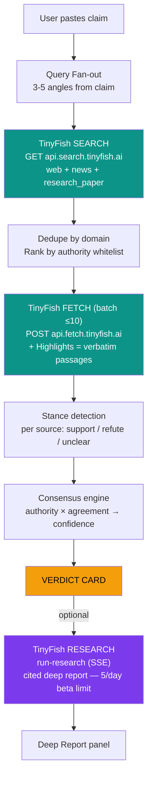

# ClaimCheck — Full Masterplan (KRITICAL HACKS'26 Online Round)

> **Status:** 🟢 GO
> **Deadline:** 20 Oct 2026 (today) — this is a **~24-hour sprint**, not a project plan
> **Finale:** 31 Oct – 1 Nov 2026 (24h, on-site)
> **Team:** ⚠️ **SOLO** — teammate B is out sick. **The AI agent is your backend engineer**
> (writes all code). You do only the human-only tasks: API key, deploy, QA, video, social, submit.
> **Prize pool:** ₹1,75,000+ · Judged out of **100 points**

---

## 0. ⚠️ SOLO OVERRIDE (read this instead of §6)

You're alone with ~24h. Two people meant one coded while one documented. Now **every minute
of coding competes with the video/README/social work** — and those three earn 40 of 100 points
on their own. So we invert the normal instinct: **stop coding early, document hard.**

**The new division of labour:**

| The AI agent does (all of it, automatically) | YOU do (cannot be delegated) |
|---|---|
| Every source file: `lib/`, `api/`, `components/`, `page.tsx` | Create TinyFish account + API key |
| Scoring engine + unit tests | `npm install` + `npm run dev`, tell me errors |
| README, eval set, `.env.example` | Manual QA on 5 claims |
| | **Deploy to Vercel** |
| | **Record the demo video** |
| | **Post on LinkedIn/X** |
| | **Submit on Unstop** |

**Re-prioritised order (solo):**
1. 🔴 **Core verdict pipeline** — claim → Search → Fetch(+Highlights) → stance → verdict.
   This alone gets you the product, most of TinyFish(20) and the Innovation(20) story.
2. 🔴 **Deploy to Vercel** — a public URL is worth more than a perfect local build.
3. 🟡 **Video + README + social post** — 40 pts live here. **Protect this time.**
4. 🟢 Deep Dive (Research API) — **only after 1–3 are done.** It's the shiniest but lowest
   ROI-per-hour and has the 5/day beta limit. Skip it without guilt if time runs out.

**Cut for solo (do not build):** eval accuracy set ❌, bookmarklet ❌, PDF export ❌,
history ❌, dark-mode polish ❌. Every one of those is a trap that steals video time.

**Hard rule:** at **T+13h** you stop coding whatever state the app is in, and switch to
video → README → social → submit. A rough app with a great video beats a great app with no video.

---

## 1. The Pitch (memorise this — you'll say it 20 times today)

**One-liner:**
> **ClaimCheck** verifies any statement against the live web in ~15 seconds and shows you
> *exactly* the sentences that prove it — quoted word-for-word, so the AI can't hallucinate the evidence.

**30-second version:**
> Misinformation doesn't lose because people are gullible — it wins because checking takes
> too long. ClaimCheck takes a claim, fans out live web searches, pulls the real pages,
> and extracts the *verbatim* sentences that support or contradict it, then scores a verdict
> across sources. Every quote on screen is an exact substring of a live web page — proven,
> not generated. The core verdict runs on TinyFish's free Search + Fetch APIs, so a check
> costs us almost nothing, which is what makes the pricing work.

---

## 2. Why This Wins — Rubric Mapping (target 85+/100)

| Criteria | Pts | How ClaimCheck takes it | Target |
|---|---|---|---|
| Working GitHub project | 20 | Public repo from hour 1, ~25 granular commits, README w/ Mermaid diagram + screenshots, LICENSE, `.env.example` | **18** |
| TinyFish integration | 20 | **3 of 5 APIs** in the core loop: Search (fan-out) → Fetch (batch extract + **Highlights**) → Research (Deep Dive). Cost table + architecture in README | **19** |
| Social media post | 10 | Public LinkedIn + X posts with GIF, repo link, project-only focus | **9** |
| Technique | 10 | Free-tier-only core pipeline, LRU claim-cache, SSE streaming, Zod-validated responses, graceful degradation, source-authority scoring model, an **accuracy eval set** | **9** |
| Innovation & idea | 20 | **Verbatim-evidence verification** (Highlights = passages are exact substrings, cannot hallucinate) + multi-source consensus + stance matrix. Not a wrapper | **17** |
| Impact & usefulness | 10 | Real users: student researchers, journalists, teachers, election-season citizens. India-specific fact-checker sources | **9** |
| Revenue model | 10 | Competitor-anchored pricing, ~95% margin on verdicts because core APIs are free | **9** |
| **Total** | **100** | | **~90** |

**The single biggest lever:** the words *"quoted word-for-word, so the AI can't hallucinate"*
is your innovation story. Lead with it in README, video, and social post.

---

## 3. Product Scope — 24h Discipline

### ✅ MUST ship (non-negotiable — these earn the points)
1. Paste a claim → **verdict card** (Verified / Misleading / Disputed / Unverified + confidence %)
2. **Evidence panel**: per-source cards with the *verbatim* quoted sentences, source name, domain, date
3. **Source authority** bar per source (transparent formula, documented in README)
4. **Pipeline stage indicator** (Searching → Fetching → Extracting → Scoring) — makes the TinyFish work *visible*
5. **Deep Dive** button → Research API cited report, **streamed live** via SSE
6. Deployed to Vercel with a public URL (judges must click a link)
7. README with TinyFish section + architecture diagram + run instructions
8. Demo video (2–3 min) + public social post
9. 5 "Try these" sample claims (2 true, 2 false, 1 needs-context) — one-click demo for judges

### 🟡 SHOULD ship (only if MUST is done by T+13h)
- Claim history in `localStorage`
- Accuracy eval set (10 labelled claims) + measured accuracy % shown in README
- Chrome-extension-lite: "verify selection" bookmarklet
- Export verdict as PDF/Markdown

### 🛑 WON'T ship (cut without discussion)
- ❌ User accounts / auth / database
- ❌ Fine-tuned ML model (no training — no time, and the web is the model)
- ❌ Browser API / Web Agent (extra wallet cost, extra failure modes)
- ❌ Mobile app
- ❌ Auto-posting / scheduling

---

## 4. Architecture



### Data flow (the exact TinyFish calls)

| Stage | API | Call | Budget |
|---|---|---|---|
| 1. Find sources | **Search** | `GET api.search.tinyfish.ai?query=...&domain_type=news\|web\|research_paper&location=IN` — run 3–5 angles in parallel | ~5 calls/claim |
| 2. Extract evidence | **Fetch** | `POST api.fetch.tinyfish.ai` with `urls:[up to 10]`, `format:"markdown"`, `highlights:{query: <claim>, max_snippets:3}` | 1 batch/claim |
| 3. Deep report | **Research** | `POST agent.tinyfish.ai/v1/automation/run-research` `{query, mode:"deep", stream:true}` → parse SSE events | 1 run — **beta: 5/account/day** |

### The scoring formula (put this verbatim in README — it's Technique points)

```
confidence = Σ (authority(source) × stance_weight(source))   over all sources
             ─────────────────────────────────────────────────────────────
                        Σ authority(source)

stance_weight:  support = +1.0,  refute = −1.0,  unclear = 0.0
authority:      IFCN fact-checker 1.0 | global news wire 0.9 | national dailies 0.8
                gov/edu domain 0.75 | wikipedia 0.6 | aggregator/blog 0.3 | social 0.1

Verdict thresholds (confidence in [−1, 1]):
  ≥ +0.45 → ✅ VERIFIED      ≤ −0.45 → ❌ MISLEADING
  in between w/ strong sources → ⚠️ DISPUTED        too little evidence → ❔ UNVERIFIED
```

**Anti-hallucination core (your innovation):** TinyFish Fetch `highlights` returns passages
that are *"extracted, never generated — every passage is an exact substring of the fetched page."*
Store the returned text and render it in quotes. Judges can `Ctrl+F` the source page and find
the exact sentence. **This is the thing no generic ChatGPT-wrapper can claim.**

### Stance detection without an LLM (cheapest, most reliable for 24h)
1. Run Fetch **twice** per claim, with two highlight queries:
   - `highlights.query = <the claim>` → passages that mention/evaluate it
   - `highlights.query = "fact check verdict: <claim>"` → passages from fact-check pages
2. Score each extracted passage for **negation/verdict cues**: `false, misleading, unsupported, debunked, hoax, fake, no evidence, missing context, unsubstantiated, wrong` (→ refute) vs `confirmed, verified, true, accurate, evidence shows, study finds, official` (→ support).
3. If you have a **free LLM key** (Gemini/Groq), swap step 2 for a 1-line JSON classification — but **ship the heuristic first**, add the LLM as enhancement. Never block on it.

---

## 5. Tech Stack & Repo

- **Next.js 15 (App Router) + TypeScript (strict) + Tailwind** — one repo, API routes = backend, SSE streaming for Deep Dive
- **No DB.** History in `localStorage`. Fewer moving parts = fewer 3am failures.
- **Vercel** free tier for deploy (public URL + easy streaming)
- `@tiny-fish/sdk` **or** plain `fetch` — plain `fetch` is fine and shows the raw API (good for the video)

**Repo layout:**
```
claimcheck/
├── app/
│   ├── page.tsx                    # hero + claim input + verdict + evidence
│   ├── api/verify/route.ts         # ⭐ Search + Fetch + scoring pipeline
│   ├── api/deep-dive/route.ts      # ⭐ Research API SSE proxy
│   └── layout.tsx, globals.css
├── lib/
│   ├── tinyfish.ts                 # ⭐ API clients + Zod schemas
│   ├── fanout.ts                   # claim → 3-5 search angles
│   ├── scoring.ts                  # ⭐ authority + stance → verdict
│   ├── authority.ts                # source whitelist + weights
│   └── cache.ts                    # in-memory LRU keyed by claim hash
├── components/
│   ├── VerdictCard.tsx  EvidenceCard.tsx  PipelineStages.tsx
│   ├── SourceBar.tsx    DeepReport.tsx    SampleChips.tsx
├── eval/claims.json                # 10 labelled claims (Technique bonus)
├── README.md  LICENSE  .env.example  .gitignore
```

**Commit rhythm:** ~25 commits, Conventional Commits (`feat:`, `fix:`, `docs:`, `chore:`).
Judges score "visible commits" — commit every working increment, never one giant dump.

---

## 6. The 24-Hour Sprint (T+0 = now, map to your clock)

### ⚡ PHASE 0 — Kickoff (T+0 → T+0.5h) · BOTH
- [ ] **B:** Sign up at `agent.tinyfish.ai` → create API key at `/api-keys`
- [ ] **B:** Verify key with a raw curl (Search, then Fetch). *Nothing proceeds until this works.*
- [ ] **A:** Create **public** GitHub repo `claimcheck` (description + topics: `ai`, `fact-check`, `tinyfish`)
- [ ] **A:** Register team on Unstop (don't leave this to the last hour)
- [ ] **B:** `npx create-next-app@latest claimcheck --ts --tailwind --app`
- [ ] **Both:** First commit: `chore: scaffold next.js app`. Add LICENSE (MIT), `.gitignore`, `.env.example` (`TINYFISH_API_KEY=`).
- [ ] **A:** Write skeleton `app/page.tsx` — input box, button, three empty panels.

> 🚩 **Gate 1 (T+0.5h):** key works, repo public, skeleton renders.

### ⚙️ PHASE 1 — Live data on screen (T+0.5h → T+3h) · B leads, A on UI
- [ ] **B:** `lib/tinyfish.ts` — `search(query, opts)` + `fetch(urls, opts)` with Zod response schemas, `X-API-Key` header, timeouts, typed errors.
- [ ] **B:** `api/verify/route.ts` — v1: just fan-out **3 search queries** (claim, claim+"fact check", claim+"debunked evidence") and return merged results.
- [ ] **B:** Commit `feat: tinyfish search client + verify endpoint`.
- [ ] **A:** Render raw results list so you can *see* live web data in the UI.
- [ ] **B:** Add `api/fetch.ts` — batch up to 10 URLs, `format:"markdown"`, request **Highlights**.
- [ ] **A:** Build `PipelineStages.tsx` — animated 4-step indicator (this sells the TinyFish work in the video).

> 🚩 **Gate 2 (T+3h):** paste claim → **real live web results** appear. Screenshots taken.

### 🔍 PHASE 2 — The verdict engine (T+3h → T+8h) · BOTH
- [ ] **B:** `lib/fanout.ts` — extract entities (capitalised words, digits, org suffixes) → generate 3–5 angles. Include `domain_type=news` + `location=IN`.
- [ ] **B:** `lib/authority.ts` — whitelist map (IFCN fact-checkers: AltNews, BoomLive, FactChecker.in, AFP; wires: Reuters, AP, AFP; national: The Hindu, Indian Express, TOI; `gov.in`, `edu`; Wikipedia).
- [ ] **B:** `lib/scoring.ts` — implement the formula in §4. Export pure function + add 3 unit tests (true, false, thin-evidence). *Cheap Technique points.*
- [ ] **B:** Handle the **Highlights 403 fallback** (see §9 Risk R1) — if Highlights unavailable, extract a ±2-sentence window around claim keywords from `text`.
- [ ] **A:** `VerdictCard.tsx` (big colour-coded verdict + confidence ring) + `EvidenceCard.tsx` (source, date, quoted passage, support/refute badge).
- [ ] **Both:** Test 6 real claims end-to-end. Tune cue words. Commit granularly.

> 🚩 **Gate 3 (T+8h):** claim in → verdict + quoted evidence out. **This is your product. Demo it now to a friend.**

### 🧠 PHASE 3 — Deep Dive + polish (T+8h → T+11h) · B leads, A polishes
- [ ] **B:** `api/deep-dive/route.ts` — Research API, parse SSE (`created` → `plan_updated` → `sources_searched` → `partial_summary` → `final_result` → `done`). Proxy events to the browser as a stream.
- [ ] **A:** `DeepReport.tsx` — live-updating progress ("Searching 8 sources…", "Synthesising…") then rendered cited report with source chips. *This is the money shot of the video.*
- [ ] **B:** ⭐ **Cache research runs**: store `research_run_id` per claim hash. Repeat demos fetch instantly via `GET /v1/research-run/{id}`. *(Beats the 5–20 min latency and the 5/day limit.)*
- [ ] **B:** `lib/cache.ts` — in-memory LRU for verdicts (repeat claim = instant). Saves your 5/day Research budget.
- [ ] **A:** Sample claims chips, empty/loading/error states, responsive layout, dark mode.

> 🚩 **Gate 4 (T+11h):** full experience works: verdict in ~15s, Deep Dive streams.

### 🚀 PHASE 4 — Ship it (T+11h → T+13h) · BOTH
- [ ] **B:** Deploy to Vercel, set `TINYFISH_API_KEY` env var, verify public URL works on a phone.
- [ ] **A:** `SampleChips.tsx` — one-click claims that reliably produce a clean demo.
- [ ] **Both:** Run the full QA pass (§12). Commit.
- [ ] **🛑 FREEZE FEATURES at T+13h.** No new code after this unless it's a bug.

> 🚩 **Gate 5 (T+13h):** live public URL + frozen codebase. **Everything below is documentation, not code.**

### 🎬 PHASE 5 — Demo video (T+13h → T+15h) · A directs, B operates
- [ ] Record with **Loom** (free, gives a link) or **OBS** (local file → upload). Script in §11.
- [ ] Pre-warm the Deep Dive cache (start the run 20 min before recording) so the video has zero 10-minute waits.
- [ ] Capture the pipeline stages, the verbatim quotes, and one `Ctrl+F` proof moment.

### 📖 PHASE 6 — README (T+15h → T+17h) · B writes, A reviews
- [ ] Structure in §10. Include Mermaid diagram, TinyFish cost table, screenshots, run instructions.

### 📣 PHASE 7 — Social post (T+17h → T+18.5h) · A writes, B posts
- [ ] LinkedIn + X posts from §13. Public. Repo link + GIF. Check it renders in incognito.

### ✅ PHASE 8 — QA + submit (T+18.5h → T+21h) · BOTH
- [ ] Full checklist §12. Then **submit on Unstop**.
- [ ] **T+21 → T+24: BUFFER.** Unstop will be slow at midnight. Submit with hours to spare, then sleep.

---

## 7. TinyFish Integration Playbook (the 20 points)

**Get the key (T+0):** `agent.tinyfish.ai/api-keys` → store as `TINYFISH_API_KEY`.
All requests need header `X-API-Key: <key>`. Server-side only — **never** put it in client code.

**Search — `GET https://api.search.tinyfish.ai`**
```bash
curl "https://api.search.tinyfish.ai?query=dengue+vaccine+india&domain_type=news&location=IN" \
  -H "X-API-Key: $TINYFISH_API_KEY"
```
Useful params: `domain_type` (`web`|`news`|`research_paper`), `recency_minutes`, `after_date`/`before_date`,
`location`/`language` (geo-target — great for India-specific claims), `purpose` (state intent → better results).

**Fetch — `POST https://api.fetch.tinyfish.ai`**
```bash
curl -X POST https://api.fetch.tinyfish.ai \
  -H "X-API-Key: $TINYFISH_API_KEY" -H "Content-Type: application/json" \
  -d '{"urls":["https://example.com/a","https://example.com/b"],"format":"markdown",
       "highlights":{"query":"<THE CLAIM>","max_snippets":3}}'
```
- Up to **10 URLs per request** → one batch per claim.
- Renders JS, extracts PDF text. Per-URL failures land in `errors[]` without failing the batch — **handle them**.
- `ttl:0` forces a live fetch (skip cache) — use when you need freshness for the video.

**Research — `POST https://agent.tinyfish.ai/v1/automation/run-research`** (SSE)
```bash
curl --no-buffer -X POST https://agent.tinyfish.ai/v1/automation/run-research \
  -H "X-API-Key: $TINYFISH_API_KEY" -H "Content-Type: application/json" \
  -d '{"query":"Is <claim> true? Cite sources.","mode":"deep","stream":true}'
```
Parse `data:` lines: `created` → `plan_updated` → `sources_searched` → `source_fetched` →
`partial_summary` → `synthesis_delta` → `final_result` → `run_stats` → `done`.

**💰 Budget reality — put this table in the README (big Technique + Revenue points):**

| API | Free allowance | Used per ClaimCheck verdict | Verdict cost |
|---|---|---|---|
| Search | 12,000 req/**day** | ~4–5 | **₹0** |
| Fetch | 1,000 URLs/**day** | ≤10 (one batch) | **₹0** |
| Research | **5 runs/day (beta)** | 1 (optional Deep Dive) | metered — capped by us |

> **This is your business-model superpower:** the core product is essentially free to run at
> consumer scale. Say it out loud in the pitch and the README.

---

## 8. Risk Register & Contingencies (read this BEFORE Phase 2)

| # | Risk | Probability | Mitigation |
|---|---|---|---|
| **R1** | **Highlights returns `403`** (it's beta, enabled per-account) | **HIGH** | Detect 403 immediately. Fallback: use returned `text` (markdown) and extract a ±2-sentence window around claim keywords. **Test Highlights in Phase 1, not Phase 2.** If unavailable, email TinyFish support — but don't wait on them. |
| **R2** | Research API slow (5–20 min) or over 5/day limit | HIGH | Keep Deep Dive **optional**. Cache `research_run_id` per claim → instant replay. Pre-warm before recording. If 429 `DAILY_LIMIT_EXCEEDED`, show the verdict core and say "deep report queued". |
| **R3** | Vercel SSE buffering kills the live stream | MED | Set `export const runtime = "nodejs"` and `export const dynamic = "force-dynamic"`; use `ReadableStream` + `TextDecoder`; test on the **deployed** URL, not `localhost`. |
| **R4** | Verdict is wrong/embarrassing on a live claim | MED | Never demo a fresh claim. Use the **5 pre-tested sample claims** for the video and for judges. Tune thresholds on the eval set. |
| **R5** | No LLM key for stance | LOW | Heuristic cue-word scoring (§4) is sufficient and *more* defensible ("no black box"). |
| **R6** | One person's machine dies | MED | **Both push to GitHub continuously.** A laptop with a browser + the public Vercel URL is enough to present. |
| **R7** | Runs out of time before submission | MED | Features freeze at **T+13h**. Submit by **T+21h**. Unstop at 11:55 PM is a death sentence. |

---

## 9. README Blueprint (write at Phase 6)

```markdown
# ClaimCheck — verify any claim against the live web, with proof

> Paste a claim. Get a verdict in ~15s — with the exact sentences that prove it,
> quoted word-for-word from live pages. The AI can't hallucinate the evidence.

## ✨ How it works
[Mermaid diagram from §4]

## 🐟 TinyFish integration   ← make this its own section, judges look for it
| Stage | TinyFish API | Why this API |
|---|---|---|
| Find sources | **Search** | fresh ranked results, news/research filters, geo-targeting |
| Extract evidence | **Fetch** + **Highlights** | renders JS, and Highlights returns *verbatim* passages that cannot be hallucinated |
| Deep report | **Research** | source-backed synthesis with citations, streamed live |

[Free-allowance cost table from §7]
[Exact code snippet of the fetch-with-highlights call]

## 🧮 Scoring model
[formula from §4 — authority weights + thresholds]

## 📊 Accuracy
[eval set of 10 labelled claims + measured accuracy %]

## 🚀 Quick start
git clone … && npm i && cp .env.example .env.local  # add your TINYFISH_API_KEY
npm run dev → http://localhost:3000

## 💰 Pricing
[three tiers from §14]

## 🛠️ Tech
Next.js 15 · TypeScript · Tailwind · TinyFish SDK · Vercel

## 👥 Team · 📄 MIT License
```

---

## 10. Demo Video Script (2–3 min, shot-by-shot)

| Time | Visual | Voiceover |
|---|---|---|
| 0:00–0:15 | Claim text on screen, blurred sources behind | "A false claim can reach millions in minutes. Checking it used to take a journalist an hour." |
| 0:15–0:35 | You, talking or title card | "ClaimCheck verifies any statement against the live web in fifteen seconds — and shows the proof." |
| 0:35–1:20 | **Live demo:** paste claim → click Verify → pipeline stages animate → verdict card + evidence cards with quotes | "I paste a claim. ClaimCheck fans out live searches, pulls the real pages, and extracts the exact sentences that support or contradict it. Every quote is copied word-for-word from the page." |
| 1:20–1:35 | **Ctrl+F a quote on the actual source page** | "See? Ctrl+F on the real page. The evidence is extracted, not generated — so it can't hallucinate." |
| 1:35–2:00 | **Deep Dive:** click → live progress → cited report streams in | "For a full cited report, Deep Dive runs TinyFish's Research API and streams the synthesis live." |
| 2:00–2:25 | Architecture slide (the Mermaid diagram) | "Three TinyFish APIs power it: Search to find, Fetch to extract verbatim evidence, Research to synthesise. The core verdict uses their free tier — so a check costs almost nothing." |
| 2:25–2:50 | Pricing + who it's for | "Built for student researchers, journalists and teachers. Free tier for everyone, ₹399 pro, teams and API for newsrooms." |
| 2:50–3:00 | Repo URL + name | "Open source at github.com/<you>/claimcheck. Try it — paste any claim." |

**Recording rules:** 1080p, kill notifications, zoom on small text, one clean take per section,
**pre-warm Deep Dive 20 min early**, record the Ctrl+F proof moment. Upload → YouTube *unlisted* or Loom link.

---

## 11. Social Post Templates (public — jury must open them without login)

**LinkedIn** (project-focused, no hackathon mention required):
> 🔍 **Anyone can generate misinformation. Verifying it still takes an hour.**
>
> So I built **ClaimCheck** — paste any claim, get a verdict in ~15 seconds.
> What makes it different: it shows the *exact sentences* that prove the verdict,
> **quoted word-for-word from live web pages**. The evidence is extracted, never generated —
> so it literally cannot hallucinate its sources. Ctrl+F any quote on the original page and it's there.
>
> Powered by @TinyFish Search + Fetch + Research APIs:
> • Search → fans out live queries across news + web + research papers
> • Fetch → renders real pages and pulls verbatim evidence passages
> • Research → optional cited deep report, streamed live
>
> Built for student researchers, journalists and teachers drowning in unverified forwards.
>
> 🧑‍💻 Open source → github.com/<you>/claimcheck
> 🎥 2-min demo → <link>
> #AI #Misinformation #FactCheck #WebDevelopment

**X/Twitter** (shorter):
> built ClaimCheck: paste a claim → verdict in 15s → shows the *verbatim* sentences that prove it, quoted word-for-word from live pages.
>
> evidence is extracted, not generated. so it can't hallucinate its sources. Ctrl+F and see.
>
> runs on @Tiny_Fish Search + Fetch + Research.
> 🧑‍💻 github.com/<you>/claimcheck
> 🎥 <demo link>

✅ Post **public**. Include repo link + GIF/screenshots. Verify in an incognito window before submitting.

---

## 12. QA & Submission Checklist (do this at T+18.5h)

**Product**
- [ ] Fresh incognito, cold cache: paste each of the 5 sample claims → all render a sane verdict
- [ ] Deliberately wrong claim → shows "Unverified" gracefully (not a crash)
- [ ] 100-char nonsense input → graceful, not a stack trace
- [ ] Deep Dive works **on the deployed URL** (not just localhost)
- [ ] Mobile viewport renders

**Repo**
- [ ] Repo is **public**
- [ ] README renders (Mermaid, images, tables) — check the GitHub preview
- [ ] `.env.example` present; **no API key anywhere in git history** (`git log -p | grep -i tinyfish`)
- [ ] `LICENSE`, `.gitignore`, granular commits, clear description + topics

**Links**
- [ ] Demo video plays (unlisted YouTube/Loom) — watch it once end-to-end
- [ ] Social post is **public** and opens in incognito
- [ ] Deployed app URL loads for someone else

**Unstop submission**
- [ ] Repo link
- [ ] Demo video link (2–3 min, shows TinyFish usage)
- [ ] Social post link
- [ ] Short write-up explaining **how TinyFish is used** (copy from README §TinyFish)
- [ ] ✅ **Submitted with hours to spare**

---

## 13. Revenue Model & Market Research (10 points)

**Positioning:** "Verification-as-a-service for the live web."

### Pricing (anchored to real competitors — verify starred figures before submitting)

| Tier | Price | Includes | Why this price |
|---|---|---|---|
| **Free** | ₹0 | 5 verdicts/day, no Deep Dive, source panel | CAC driver; costs us ~₹0 because Search+Fetch are free |
| **Pro** | **₹399/mo** (~$4.8) | Unlimited verdicts, 10 Deep Dive reports/mo, history, PDF export | Undercuts researcher/student tooling; below one hour of a fact-checker's time |
| **Team** | ₹3,999/mo (~$48) | 5 seats, API (10k calls), custom source whitelist, priority | Anchored to news-API business tiers ($449/mo class) at a fraction |
| **Enterprise / API** | ₹2 per verdict · ₹45 per Deep Dive run | Volume SLA, on-prem options, compliance | Usage-based mirrors how TinyFish meters us |

### Competitive anchors (starred = confirm on their pricing page today)
| Product | Price | Overlaps with |
|---|---|---|
| NewsAPI.org Business* | ~$449/mo | raw news data (we return verdicts, not links) |
| SerpAPI Basic* | ~$75/mo | search plumbing only |
| Ground News (consumer)* | ~$9.99/mo | bias/blindspot, not verbatim-proof verification |
| Originality.ai* | ~$14.99/mo + per-word | AI-detection, adjacent "trust" budget |
| **TinyFish Search+Fetch** | **free** (12k searches + 1k fetches/day) | our cost base — the margin story |

### Unit economics (the part that impresses juries)
```
Cost per verdict  = ~5 Search + 1 Fetch batch  →  effectively ₹0 within free limits
Gross margin      ≈ 95%+ on Free/Pro verdicts
Deep Dive         = Research run (beta, 5/day) → metered, capped at 10/mo on Pro
Break-even        ≈ 12 Pro subscribers covers typical Vercel + wallet costs
```
**Supply-side truth to state honestly:** our core is free because TinyFish's Search/Fetch free
tier is generous. We price on the *verdict value*, not the API cost. That's a defensible moat
*and* an honest disclosure — juries reward honesty.

### Go-to-market (10 points love a real channel plan)
1. **Now:** LinkedIn + X launch post, college tech clubs, r/IndianAcademia-adjacent communities
2. **30 days:** Chrome bookmarklet, Notion/Slack integration, "verify this forward" WhatsApp-shareable card
3. **90 days:** Newsroom pilots (regional dailies), edtech bulk licensing, election-observation NGOs
4. **Moat:** source-authority model tuned per language/region + accuracy benchmarks others can't replicate cheaply

### Market sizing (⚠️ verify a fresh figure and cite the source — do not invent precision)
- Directionally: India is the world's largest internet audience with high misinformation exposure
  around elections and health claims; global misinformation-detection spend is a multi-billion-$
  market growing double-digit annually.
- **Action:** pull **one** citable figure from a public market-research summary or an IFCN report,
  drop it in the README with a link. A single sourced number beats five invented ones.

---

## 14. Finale Prep (31 Oct – 1 Nov · 24h on-site)

Do **after** submission, this week:
- [ ] **Pitch deck** (8 slides): problem → demo → verbatim-proof innovation → TinyFish architecture → accuracy numbers → pricing → traction plan → ask
- [ ] **Offline backup:** cloned repo + `npm run build` + exported static demo + the recorded video on a USB. Assume venue Wi-Fi dies.
- [ ] **Accuracy benchmark:** finalise the 10-claim eval set, report a real accuracy % — juries love a number.
- [ ] **Anticipated jury Q&A:**
  - *"Why TinyFish over scraping / a search API?"* → verbatim Highlights + JS rendering + one key for 3 capabilities.
  - *"What if the verdict is wrong?"* → confidence thresholds + "Disputed"/"Unverified" states + transparent scoring.
  - *"Cost at 1M users?"* → Search+Fetch free tier math; meter only Deep Dive.
  - *"Why will anyone pay?"* → a journalist's hour vs ₹399.
  - *"Data privacy?"* → no accounts, no storage, stateless verification.
- [ ] Rehearse the 3-minute pitch **out loud** 5×.

---

## 15. Immediate Next Actions (do these in the next 30 minutes)

1. **B** → sign up at `agent.tinyfish.ai`, create key, run the two curl tests in §7 ✅ verify
2. **A** → create public GitHub repo + register on Unstop
3. **Both** → scaffold Next.js, first commit
4. **B** → tell A the moment Search returns live results
5. Start the clock. 🚀
