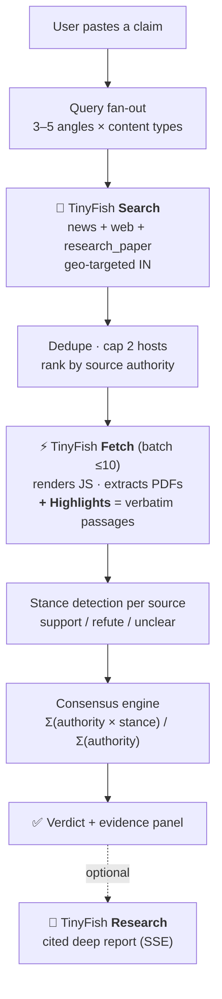

# ClaimCheck

> **Verify any claim against the live web in ~15 seconds — with the exact sentences that prove it.**

Paste a claim. ClaimCheck fans out live web searches, pulls the real pages, and extracts the
**verbatim** passages that support or contradict it, then scores a verdict across sources.

**The core idea:** every quote you see is an *exact substring* of a live web page. The evidence is
**extracted, never generated** — so the system cannot hallucinate its sources. Don't trust the
verdict? `Ctrl+F` the quote on the original page and it's right there.

---

## ✨ Why it's different from "ask an LLM"

| | Chat-with-a-model | ClaimCheck |
|---|---|---|
| Evidence | Generated prose that *sounds* cited | **Verbatim quotes** lifted from live pages |
| Can it hallucinate a source? | Yes | **No** — passages are substrings of fetched HTML |
| Is the method auditable? | Black box | **Published** weights + cue words + formula |
| Cost per check | Paid tokens | **~₹0** (TinyFish free tier) |

---

## 🧠 How it works



**1. Fan-out** — a single search of a vague claim is easy to fool. ClaimCheck derives 3–5 angles
(entity extraction, `fact check`, `evidence`, official statements, and an academic angle when the
claim sounds scientific) and queries across `news`, `web` and `research_paper` content types.

**2. Fetch + Highlights** — the top sources are fetched in one batched call. TinyFish's
[Highlights](https://docs.tinyfish.ai/fetch-api) returns passages that are
*"extracted, never generated — every passage is an exact substring of the fetched page."*
That is the anti-hallucination guarantee the whole product rests on.

**3. Consensus** — each source gets an authority weight and a stance. They're combined into a
signed confidence value; sources disagreeing is itself a first-class answer (`DISPUTED`).

---

## 🐟 TinyFish integration

ClaimCheck uses **three of TinyFish's five API surfaces** as the actual engine — not a token mention.

| Stage | TinyFish API | Endpoint | Why this API |
|---|---|---|---|
| Find sources | **Search** | `GET api.search.tinyfish.ai` | Fresh ranked results with `domain_type`, `location` and `purpose` filters — essential for India-specific claims |
| Extract evidence | **Fetch + Highlights** | `POST api.fetch.tinyfish.ai` | Renders JavaScript, extracts PDF text, and returns **verbatim** passages that cannot be hallucinated |
| Deep report | **Research** | `POST agent.tinyfish.ai/v1/automation/run-research` | Source-backed synthesis with citations, streamed live over SSE |

### The exact call that powers the evidence panel

```bash
curl -X POST https://api.fetch.tinyfish.ai \
  -H "X-API-Key: $TINYFISH_API_KEY" \
  -H "Content-Type: application/json" \
  -d '{
    "urls": ["https://www.example.com/a", "https://www.example.com/b"],
    "format": "markdown",
    "highlights": { "query": "<THE CLAIM>", "max_snippets": 3 }
  }'
```

Each result gains a `highlights` array of ranked, word-for-word passages. An **empty list** means
the page doesn't answer the question — a deliberate, calibrated signal rather than a forced guess.

### Cost table — this is the business-model superpower

| API | Free allowance | Used per verification | Effective cost |
|---|---|---|---|
| Search | **12,000 requests/day** | ~4–5 | **₹0** |
| Fetch | **1,000 URLs/day** | ≤10 (one batch) | **₹0** |
| Research | 5 runs/day (beta) | 1 (optional) | metered, capped by us |

A consumer-scale verification product that costs essentially nothing to run — that's what makes
the free tier and the ₹399 Pro tier both viable.

### Graceful degradation
- **Highlights 403** (it's beta, enabled per-account): falls back to full-text extraction and
  keyword-window passage selection. The verdict still works; only the verbatim guarantee softens.
- **Research 429** (5 runs/day beta limit): deep reports are surfaced as optional and rate-limit
  aware. The core verdict is unaffected — it never touches the paid APIs.
- **Repeat claims**: memoised, so re-running a demo claim is instant and free.

---

## 🧮 Scoring model

```
confidence = Σ ( authority(source) × stance_weight(source) )  over all sources
             ───────────────────────────────────────────────────────────────
                              Σ authority(source)

stance_weight:  support = +1     refute = −1     unclear = 0
```

**Source authority weights** (first match wins):

| Weight | Category | Examples |
|---|---|---|
| 1.00 | Fact-checker | AltNews, BoomLive, FactChecker.in, AFP Fact Check, Snopes |
| 0.90 | News wire | Reuters, AP, Bloomberg, PTI |
| 0.80 | News organisation | The Hindu, Indian Express, NDTV, BBC |
| 0.75 | Official / govt | `gov.in`, PIB, RBI, WHO, UN |
| 0.70 | Academic | `*.edu`, `*.ac.in`, arXiv, PubMed, The Lancet |
| 0.60 | Encyclopedic | Wikipedia, Britannica |
| 0.50 | General web | — |
| 0.30 | Blog / opinion | Medium, Substack |
| 0.10 | Social / UGC | X, Reddit, YouTube (near-zero evidentiary value) |

**Verdict thresholds** (confidence ∈ [−1, 1]):

| Range | Verdict |
|---|---|
| ≥ +0.45 | ✅ **Supported** |
| ≤ −0.45 | ❌ **Misleading** |
| ±0.15 – ±0.45 | ⚠️ **Disputed** (credible sources disagree) |
| low total authority | ❔ **Unverified** (refuses to guess) |

**Stance detection** runs on the extracted passages using published cue words
(`false`, `debunked`, `unsupported`, `no evidence`… vs `confirmed`, `study finds`,
`official records`…). Fact-checker sources get a 1.5× boost on refute cues because their verdict
language is explicit and deliberate. It's **deterministic, free and auditable** — a wrong verdict
can always be traced to a specific cue, which is not true of a black box.

---

## 🚀 Quick start

```bash
git clone https://github.com/<you>/claimcheck.git
cd claimcheck
npm install
cp .env.example .env.local
#  → put your key in .env.local:  TINYFISH_API_KEY=...
npm run dev
```

Open http://localhost:3000 and paste a claim, or click one of the sample chips.

**Get a TinyFish key:** https://agent.tinyfish.ai/api-keys — Search and Fetch are free, no card needed.

```bash
npm test          # unit tests for the consensus engine
npm run typecheck # strict TypeScript, zero any
npm run build     # production build
```

---

## 🌐 API

| Route | Method | Body | Returns |
|---|---|---|---|
| `/api/verify` | POST | `{ claim }` | **NDJSON stream** of stage events, then the verdict |
| `/api/deep-dive` | POST | `{ claim, runId? }` | **NDJSON stream** of Research progress + cited report |

Both stream `application/x-ndjson` so the UI can animate pipeline stages in real time — you watch
it search, fetch, extract and score rather than staring at a spinner.

---

## 📁 Project structure

```
app/
  api/verify/route.ts      # Search → Fetch → score pipeline (NDJSON stream)
  api/deep-dive/route.ts   # Research API SSE proxy, with run replay
  page.tsx                 # UI orchestration
lib/
  tinyfish.ts              # TinyFish clients (raw fetch, Zod-validated)
  fanout.ts                # claim → 3–5 search angles
  authority.ts             # published source-weight table
  stance.ts                # cue-word classifier + keyword-window fallback
  scoring.ts               # consensus engine (pure, unit-tested)
  cache.ts                 # LRU + claim hashing
eval/claims.json           # labelled claim set incl. a nonsense control case
```

---

## 🛠️ Tech

Next.js 15 (App Router) · TypeScript (strict, zero `any`) · Tailwind CSS 4 ·
[TinyFish](https://www.tinyfish.ai) Search / Fetch / Research · Vercel · Vitest

No database, no accounts, no tracking. Verification is stateless; history lives in memory only.

---

## ⚠️ Honest limitations

- **Heuristic stance detection** can misread sarcasm, quotes-of-quotes, or heavily nested claims.
  It's tuned for plain factual statements, not opinions.
- **English-first.** Multi-language claims work via TinyFish's geo/language params but cue words
  are currently English-only.
- **Deep reports** depend on TinyFish's Research beta (5 runs/day, 5–20 min). Core verification
  never depends on it.
- **Caching** is in-memory per instance — a production deployment would swap it for Vercel KV.
- A verdict is **evidence aggregation, not truth**. That's why `Disputed` and `Unverified` exist.

---

## 💰 Pricing

| Tier | Price | Includes |
|---|---|---|
| Free | ₹0 | 5 verdicts/day, full evidence panel |
| Pro | ₹399/mo | Unlimited verdicts, 10 deep reports, history, export |
| Team | ₹3,999/mo | 5 seats, API, custom source whitelist |
| API | ₹2 / verdict · ₹45 / deep report | Volume SLA |

Core verification costs ~₹0 to serve (free-tier Search + Fetch). We price on the value of a
verified claim, not on API passthrough.

---

## 📄 License

MIT — see [LICENSE](./LICENSE).

---

<sub>Built for KRITICAL HACKS '26 · Powered by TinyFish Search, Fetch and Research APIs.</sub>
